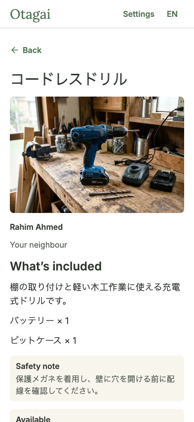

# Otagai · お互い

Otagai is a mobile app for borrowing tools and asking for everyday help within a neighbourhood. Residents join circles for their building or neighbourhood group, where they can find someone with a spare drill, ask for a hand carrying groceries, or offer a skill of their own.

Small favours can be hard to ask for when you’re unsure who to approach or how to word the request. Otagai lets you start with people you know, choose how far the request can reach, and arrange the details once someone offers.

## What you can do

- **Ask for help.** Describe what you need by text or voice. Ask searches for relevant listings and skills in your circles, follows up when it needs more detail, and lets you review a draft before posting.
- **Choose who sees a request.** Send it directly to one neighbour or start with a small group. If it stays open, Otagai can widen delivery up to the audience you chose. This is the ripple feature.
- **Lend and borrow tools.** Browse listings with photos, availability, and safety notes. Create a listing manually or start with suggestions from a photo, then arrange pickup and confirm the handover together.
- **Coordinate and say thanks.** Chat with the other person, translate individual messages on demand, and send a private thank-you after both people confirm completion. The interface is available in English, Japanese, and Bengali.
- **Help a family member remotely.** With their permission, a caregiver can post a request in the family member’s circle. Permissions are scoped and can be revoked.

## Screenshots

| Ask finds a neighbour | Browse shows a tool listing | Chat translates a message |
| --- | --- | --- |
|  |  |  |

*Screenshots from the app with seeded demo accounts.* [Figma design](https://www.figma.com/design/2UQhMRRDZKIFJZocixVIyt/Otagai-%C2%B7-Colour-Explorations) · [Screen inventory](screens.md)

## Hackathon demo

Start as Tanaka in Nagasaki. Search for help with a shelf, open a tool or skill match, then see how a Bengali reply can be translated in an existing exchange. Switch to Rahim and open Family to see how he can request help for Amina in her building circle in Cumilla. The bKash option is a payment simulation. [Demo walkthrough](docs/demo.md)

## Architecture

The Expo and React Native app signs in through Supabase Auth and calls a FastAPI backend. FastAPI checks circle membership, family consent, and exchange permissions. PostgreSQL stores requests, exchanges, and messages. Redis supports caching and queued tasks, while RustFS stores private media.

The OpenAI Agents SDK interprets Ask requests and searches eligible listings. The backend also uses OpenAI for photo suggestions and translation. Separate background processes widen open requests and deliver notifications. [Production architecture diagram](docs/architecture.md#production-architecture) · [Technical guide](docs/architecture.md)

## Develop locally

Run the API and its dependencies with Docker Compose, then connect the Expo app using a Supabase project. The development guide includes environment variables, migrations, and test commands. [Local development](docs/development.md) · [API reference](backend/docs/api-endpoints.md)

## Team

Built for the hackathon theme **繋ぐ** (*tsunagu*, to connect) by [Hemalv02](https://github.com/Hemalv02), [shyan23](https://github.com/shyan23), **fahim**, and **mithunvoe**.
