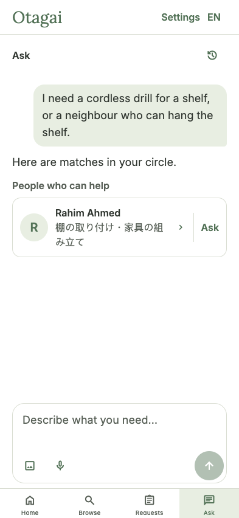
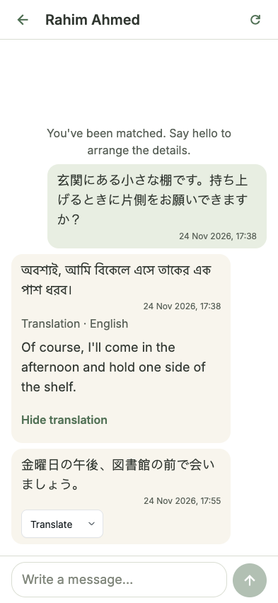

# Otagai · お互い

Otagai helps neighbours borrow tools, ask for everyday help, and thank one another. It was built for the hackathon theme **繋ぐ** (*tsunagu*, to connect), with demo communities in Nagasaki and Cumilla.

A resident can start by asking a small, trusted circle. The request can reach a wider audience if it remains open and the resident allows it. Neighbours can arrange the exchange in chat, translate individual messages, and send a thank-you afterward. Family members can also act on someone’s behalf with scoped consent.

| Ask finds a neighbour | Browse shows a tool listing | Chat translates a message |
| --- | --- | --- |
|  |  |  |

*Screenshots from the app with seeded demo accounts.*

## Explore the project

- [Demo walkthrough](docs/demo.md) follows the seeded accounts and explains the simulated bKash step.
- [Architecture](docs/architecture.md) shows how Expo, FastAPI, Supabase, PostgreSQL, Redis, and OpenAI work together.
- [Local development](docs/development.md) covers setup, tests, and deployment references.
- [Figma design](https://www.figma.com/design/2UQhMRRDZKIFJZocixVIyt/Otagai-%C2%B7-Colour-Explorations) shows the visual exploration. [Screen inventory](screens.md) maps the product flows.

Built by [Hemalv02](https://github.com/Hemalv02), [shyan23](https://github.com/shyan23), **fahim**, and **mithunvoe**.
