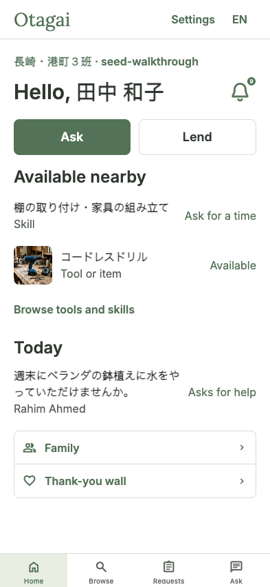
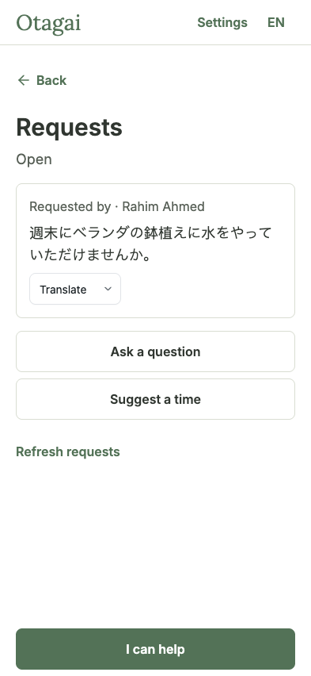
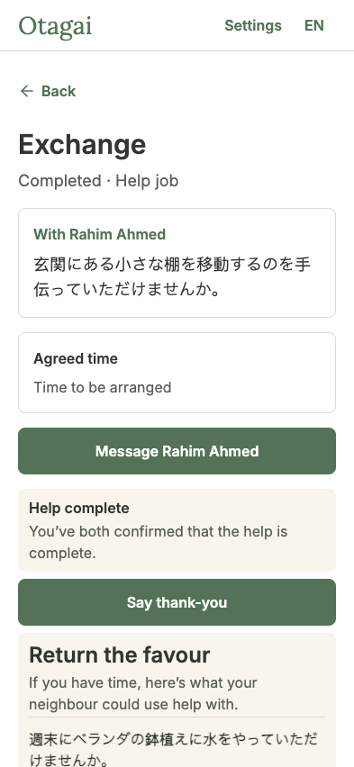
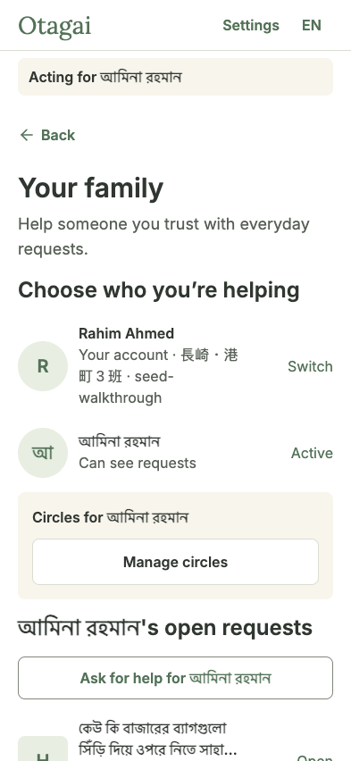
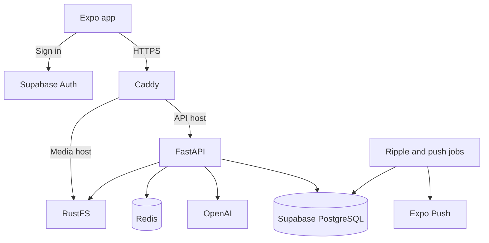

# Otagai · お互い

**Otagai is a mobile app for borrowing tools, sharing skills, and asking for everyday help within trusted neighbourhood circles.**

## Tsunagu — Update the Way We Connect

Tsunagu (繋ぐ) means “to connect.” A neighbour may have a drill to lend or time to help carry groceries, but living nearby doesn’t always make it easy to ask. Otagai helps residents start with a trusted circle, agree on the details across languages, and thank the person who helped. With permission, relatives who live elsewhere can also connect a family member with help in their own neighbourhood.

[How it works](#how-it-works) · [Screenshots](#screenshots) · [Architecture](#architecture) · [Run locally](#run-locally)

## How it works

1. **Join a circle.** Sign up by email, then find your building or neighbourhood circle by invite or location. Request membership and wait for approval where required.
2. **Find a tool or ask for help.** Browse the circle’s catalogue, or describe a task in Ask by text or voice. Ask can find tools and people with relevant skills, ask a follow-up question, or prepare an editable request.
3. **Choose who receives the request.** Send it to one person or start with a small group. The ripple feature can widen delivery while the request is open, up to the audience you chose.
4. **Arrange and complete the exchange.** Accept an offer and use chat to settle a time and place. For a loan, both people confirm the handover. For a favour, both confirm the task is done. Translate messages as needed and send a thank-you after completion.

Members can publish tools and skills they want to share. A tool photo can fill in a first draft of a listing, which the owner can edit before publishing. In Family, a caregiver can request help in a relative’s circle with permission for that action. The interface is available in English, Japanese, and Bengali.

## Screenshots

Captured from the app with seeded accounts. Select any screenshot to open it at full size. [Figma design](https://www.figma.com/design/2UQhMRRDZKIFJZocixVIyt/Otagai-%C2%B7-Colour-Explorations) · [Screen inventory](screens.md)

### Find and offer help

| Circle home | Tool listing | Ask assistant | Offer help |
| --- | --- | --- | --- |
| [](docs/screenshots/circle-home.png) | [](docs/screenshots/tool-listing.png) | [](docs/screenshots/assistant-match.png) | [](docs/screenshots/offer-help.png) |

### Coordinate and follow through

| Translated chat | Completed exchange | Family requests |
| --- | --- | --- |
| [](docs/screenshots/chat-translation.png) | [](docs/screenshots/completed-help.png) | [](docs/screenshots/family-assistance.png) |

## Architecture



| Layer | Stack | What it handles |
| --- | --- | --- |
| Mobile | Expo SDK 58, React Native, TypeScript, Expo Router, i18next | Screens, navigation, accessibility settings, and localized copy. |
| API | Python, FastAPI, Pydantic, SQLAlchemy | Validates requests and applies membership, consent, and exchange rules. |
| Identity, data, and media | Supabase Auth, PostgreSQL, Redis, RustFS | Email sign-in, durable app data, caching and queues, and signed URLs for private files. |
| AI | OpenAI Agents SDK and OpenAI API | Ask interprets needs and searches the permitted catalogue. OpenAI also handles transcription, photo suggestions, and on-demand translation. |
| Infrastructure | Docker Compose, Caddy, Alembic | Runs services, routes HTTPS traffic, and applies database migrations. |

FastAPI owns permissions and state changes. It checks the signed-in user and their circle access before returning Ask results. Posting requires a separate confirmation from the app. Dedicated processes handle ripple delivery and device push. [Architecture and implementation details](docs/architecture.md)

## Run locally

Use Docker Compose v2, Node.js 24 with pnpm, and a Supabase project. Python 3.12+ and uv are needed for host-side backend development and tests.

1. Configure the root `.env` and `mobile/.env.local`. Point both apps to the same Supabase project and use the local API URL in Expo. [Environment setup](docs/development.md#configure-the-environment)
2. From the repository root, apply migrations and start the API.

   ```bash
   docker compose run --rm --build backend alembic upgrade head
   docker compose up -d --wait
   curl -fsS http://127.0.0.1:8000/ready
   ```

3. In another terminal, start the app from the repository root.

   ```bash
   cd mobile
   pnpm install --frozen-lockfile
   pnpm start
   ```

   Press `w` for the browser preview. Swagger UI is available at `http://127.0.0.1:8000/docs`.

## Developer documentation

| Guide | What's inside |
| --- | --- |
| [Local development](docs/development.md) | Environment variables, code layout, local media, and test commands. |
| [Architecture](docs/architecture.md) | Request delivery, AI inputs and outputs, consent, and deployment topology. |
| [API reference](backend/docs/api-endpoints.md) | Endpoint contracts for account, circles, listings, requests, chat, and exchanges. |
| [Deployment](backend/docs/deployment.md) | Production configuration, release checks, and operations. |

## Team

- [Mominul Islam Hemal](https://github.com/Hemalv02)
- [Nafis Shyan](https://github.com/shyan23)
- [Shahriar Hossen Fahim](https://github.com/shfahiim)
- [Kabya Mithun Saha](https://github.com/mithunvoe)
