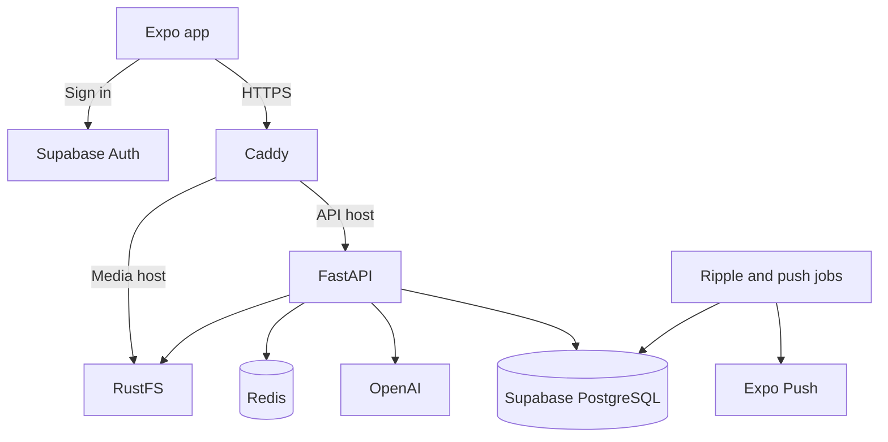

<p align="center">
  
</p>

# Otagai · お互い

**Otagai is a mobile app for borrowing tools, sharing skills, and asking for everyday help within trusted neighbourhood circles.**

Inspired by Nagasaki and the hackathon theme 繋ぐ (tsunagu, to connect), Otagai makes it easier to ask for a small favour when asking feels like imposing. A resident can draft a polite request, choose who sees it, and coordinate with a neighbour in the same app.

[What you can do](#what-you-can-do-in-the-app) · [Screenshots](#screenshots) · [Architecture](#architecture) · [Run locally](#run-locally)

## What you can do in the app

- **Join your neighbourhood circle.** Create an account with email, then find a building or neighbourhood circle by invitation or location and request membership.
- **Borrow tools and share skills.** Browse availability and safety notes, request a specific item, or list a tool or skill of your own. A tool photo can provide an editable first draft of a listing.
- **Ask for everyday help.** Describe what you need by text, voice, or photo. Ask can find tools and people with relevant skills, ask for missing details, or prepare a request you can edit. Send the request directly or let it widen up to the audience you choose.
- **Offer help and coordinate.** Respond to a neighbour’s request, suggest a time, or use chat to agree on details. Translate individual messages on demand.
- **Complete an exchange and say thanks.** Both people confirm a tool handover or completed favour. After completion, send a private thank-you.
- **Help a relative from afar.** With permission, make a request in their neighbourhood circle and see its progress.

The app interface is available in English, Japanese, and Bengali.

## Screenshots

Captured from the app with seeded accounts. Select any screenshot to open it at full size. [Figma design](https://www.figma.com/design/2UQhMRRDZKIFJZocixVIyt/Otagai-%C2%B7-Colour-Explorations) · [Screen inventory](screens.md)

### Find and offer help

| Circle home | Tool listing | Ask assistant | Offer help |
| --- | --- | --- | --- |
| [](docs/screenshots/circle-home.png) | [](docs/screenshots/tool-listing.png) | [](docs/screenshots/assistant-match.png) | [](docs/screenshots/offer-help.png) |

### Coordinate and follow through

| Translated chat | Completed exchange | Family requests |
| --- | --- | --- |
| [](docs/screenshots/chat-translation.png) | [](docs/screenshots/completed-help.png) | [](docs/screenshots/family-assistance.png) |

## Architecture



| Layer | Stack | What it handles |
| --- | --- | --- |
| Mobile | Expo SDK 58, React Native, TypeScript, Expo Router, i18next | Screens, navigation, accessibility settings, and localized copy. |
| API | Python, FastAPI, Pydantic, SQLAlchemy | Validates requests and applies membership, consent, and exchange rules. |
| Identity, data, and media | Supabase Auth, PostgreSQL, Redis, RustFS | Email sign-in, durable app data, caching and queues, and signed URLs for private files. |
| AI | OpenAI Agents SDK and OpenAI API | Ask interprets needs and searches the permitted catalogue. OpenAI also handles transcription, photo suggestions, and on-demand translation. |
| Infrastructure | Docker Compose, Caddy, Alembic | Runs services, routes HTTPS traffic, and applies database migrations. |

FastAPI owns permissions and state changes. It checks the signed-in user and their circle access before returning Ask results. Posting requires a separate confirmation from the app. Dedicated processes handle ripple delivery and device push. [Architecture and implementation details](docs/architecture.md)

### AI pipeline

[](diagrams/otagai-ai-complete-pipeline.png)

The first row shows the path to posting a request. Ask may also return a match or a follow-up question. Listing drafts and pickup suggestions are reviewed in the app before publishing or confirming. [AI implementation](docs/architecture.md#ai-and-translation)

## Run locally

Use Docker Compose v2, Node.js 24 with pnpm, and a Supabase project. Python 3.12+ and uv are needed for host-side backend development and tests.

1. Configure the root `.env` and `mobile/.env.local`. Point both apps to the same Supabase project and use the local API URL in Expo. [Environment setup](docs/development.md#configure-the-environment)
2. From the repository root, apply migrations and start the API.

   ```bash
   docker compose run --rm --build backend alembic upgrade head
   docker compose up -d --wait
   curl -fsS http://127.0.0.1:8000/ready
   ```

3. In another terminal, start the app from the repository root.

   ```bash
   cd mobile
   pnpm install --frozen-lockfile
   pnpm start
   ```

   Press `w` for the browser preview. Swagger UI is available at `http://127.0.0.1:8000/docs`.

## CI/CD

- **Pull request checks.** GitHub Actions tests the proposed merge commit when a PR opens, reopens, or receives new commits. It runs mobile lint, type checking, and tests, plus backend lint, formatting, and unit tests. The Alembic check validates the revision graph and requires a single head without connecting to a database. [CI workflow](.github/workflows/ci.yml)
- **Backend deployment.** A push to `main` triggers deployment to Azure only when it changes files under `backend/`. Docker Compose builds the backend services and applies migrations. The workflow then checks the public `/ready` endpoint. [Deploy workflow](.github/workflows/deploy-backend.yml) · [Azure runbook](deploy/README.md)

## Developer documentation

| Guide | What's inside |
| --- | --- |
| [Local development](docs/development.md) | Environment variables, code layout, local media, and test commands. |
| [Architecture](docs/architecture.md) | Request delivery, AI inputs and outputs, consent, and deployment topology. |
| [API reference](backend/docs/api-endpoints.md) | Endpoint contracts for account, circles, listings, requests, chat, and exchanges. |
| [Deployment](backend/docs/deployment.md) | Production configuration, release checks, and operations. |

## Team FnF

- [Mominul Islam Hemal](https://github.com/Hemalv02)
- [Nafis Shyan](https://github.com/shyan23)
- [Shahriar Hossen Fahim](https://github.com/shfahiim)
- [Kabya Mithun Saha](https://github.com/mithunvoe)
