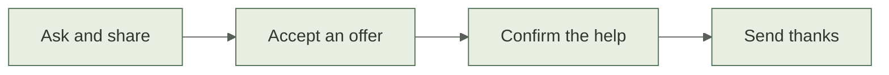
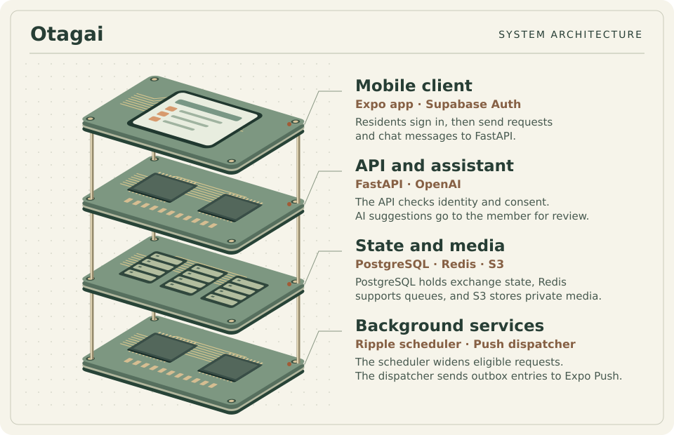
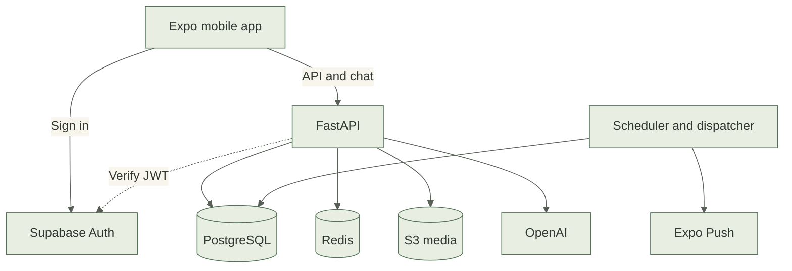

<p align="center">
  
</p>

# Otagai · お互い

**A mobile app for borrowing tools, asking for everyday help, and saying thank you within trusted neighbourhood circles.**

Inspired by Nagasaki and the hackathon theme **繋ぐ (*tsunagu*, to connect)**, Otagai makes it easier to ask for a small favour when asking feels like imposing. A resident can draft a polite request, choose who sees it, and coordinate with a neighbour in the same app.

<p align="center">
  <a href="#walkthrough">Walkthrough</a> ·
  <a href="#architecture">System Architecture</a> ·
  <a href="docs/diagram-catalogue.md">Architecture catalogues</a> ·
  <a href="#engineering-notes">Engineering notes</a> ·
  <a href="#quick-start">Quick start</a> ·
  <a href="#team">Team</a>
</p>

<p align="center">
  <code>Expo · React Native · TypeScript</code> &nbsp;
  <code>FastAPI · PostgreSQL · Redis</code> &nbsp;
  <code>OpenAI Agents SDK</code>
</p>

<a id="walkthrough"></a>

## 暮らし · Walkthrough

Tanaka-san needs a hand carrying groceries up the hill. She reviews a polite Japanese draft and shares it with a small circle. Rahim offers to help. They arrange a time in chat, confirm the exchange, and Tanaka-san sends an **お礼 (*orei*)**, a thank-you note.



<p align="center">
  
  <br><sub>Onboarding illustration · 長崎 Nagasaki</sub>
</p>

| In the app | What a neighbour can do |
| --- | --- |
| **波紋 · Ripple requests** | Start with family or a *han* (a small neighbourhood group). An open request can widen every six hours up to the audience the requester chose. Direct requests stay with their chosen recipient. |
| **道具 · Tool lending** | Take a photo to draft a listing, edit the suggested details, then publish. Borrowers can request a tool, coordinate pickup and confirm a handover checklist with the owner. |
| **敬語 · Assistant and translation** | Describe a need by text or voice, find relevant tools and help, and review a draft before posting. Exchange participants can translate individual chat messages. |
| **家族 · Family consent** | Help a relative from afar. For example, Rahim can post for a family member in Cumilla when their consent grant allows it. The grant can be revoked. |
| **お礼 · Gratitude** | Send a private note after an exchange. A shared thank-you requires permission from the sender and a separate publishing choice by the recipient. |

The seeded demo covers both Nagasaki and Cumilla, including a bilingual exchange and a consented family request. The bKash flow uses a mock payment provider. [Demo walkthrough](backend/docs/hackathon-demo.md)

<p align="center"></p>

<a id="architecture"></a>

## 設計 · Architecture



The Expo app handles interaction and rendering. FastAPI verifies identity and enforces membership, consent and workflow rules. PostgreSQL stores the workflow state, and background processes advance eligible requests and deliver notifications.



### AI drafts, people decide


The [architecture deep dive](docs/architecture.md) traces request delivery, photo-to-listing, and the deployment topology. The [API reference](backend/docs/api-endpoints.md) covers endpoint contracts.

<a id="engineering-notes"></a>

## 工夫 · Engineering notes

| Decision | Where to look |
| --- | --- |
| **Audience limits are enforced on the server.** An open request records its current stage, maximum audience, and next widening time. | [Ripple service](backend/app/services/requests/ripple.py) · [scheduler](backend/app/services/requests/scheduler.py) |
| **Family consent is scoped per action.** The server keeps the signed-in actor separate from the person they represent. Viewing activity and posting requests require distinct permissions. | [Family consent workflow](docs/family-consent.md) |
| **Push delivery survives retries.** A PostgreSQL outbox keeps delivery state, respects local quiet hours, and records Expo receipts. | [Push dispatcher](backend/app/services/notifications/dispatch.py) · [push setup](docs/request-push-setup.md) |
| **Images stay private by default.** Uploads are resized and re-encoded as WebP without EXIF metadata. Authorized clients receive short-lived signed URLs. | [Media service](backend/app/services/media/service.py) |
| **The interface supports three scripts.** Japanese, English and Bangla use shared design tokens, with type and spacing tuned for each script. | [Design tokens](mobile/src/theme/tokens.json) · [screen inventory](screens.md) |

Reviewers can trace two user-facing guarantees in the test suite. Family activity and request posting require separate grants, and a pickup requires two independent confirmations. [Family integration tests](backend/tests/integration/test_relationships.py) · [handover integration tests](backend/tests/integration/test_live_handover.py)

<a id="quick-start"></a>

## 始める · Quick start

Use Docker Compose v2, Python 3.12+ with `uv`, Node.js 22.13+ with `pnpm`, and a Supabase project for sign-in.

### 1. Start the backend

Create a `.env` at the repository root with the following values. Replace the placeholders before starting. Set `OPENAI_API_KEY` and `OPENAI_MODEL` in the same file to enable AI features.

```dotenv
POSTGRES_PASSWORD=replace-with-local-postgres-password
REDIS_PASSWORD=replace-with-local-redis-password
S3_SECRET_KEY=replace-with-local-storage-secret
SUPABASE_URL=https://your-project.supabase.co
CORS_ALLOWED_ORIGINS='["http://localhost:8081","http://127.0.0.1:8081"]'
```

Run from the repository root.

```bash
docker compose run --rm --build backend alembic upgrade head
docker compose up -d --wait
curl -fsS http://127.0.0.1:8000/ready
```

Open `http://127.0.0.1:8000/docs` for interactive API documentation. The [local media setup](docs/architecture.md#local-media-previews) explains how to serve signed images to a browser or device.

### 2. Start the app

```bash
cd mobile
cp .env.example .env.local
pnpm install --frozen-lockfile
```

Set `EXPO_PUBLIC_SUPABASE_URL` and `EXPO_PUBLIC_SUPABASE_KEY` in `mobile/.env.local` to your project URL and public client key. Run `pnpm start` and press `w` for a local browser preview. For native camera and notification testing, use a development build and set `EXPO_PUBLIC_API_URL` to an API address reachable from the device.

### 3. Run checks

```bash
# From backend/
uv run --frozen pytest -m 'not integration'

# From mobile/
pnpm exec tsc --noEmit
pnpm lint
node --experimental-strip-types --test --experimental-test-isolation=none tests/*.test.mjs
```

Integration tests use a disposable PostgreSQL database. See [backend testing](backend/docs/testing.md) for setup and [deployment](backend/docs/deployment.md) for the production Compose stack.

<a id="team"></a>

## 仲間 · Team

Built for the **繋ぐ (*tsunagu*)** hackathon theme by [Hemalv02](https://github.com/Hemalv02), [shyan23](https://github.com/shyan23), **fahim**, and **mithunvoe**.

<p align="center">
  
  <br><b>お互いさま</b> · We help each other.
</p>
