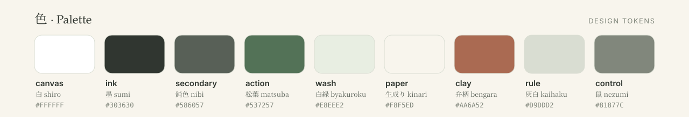
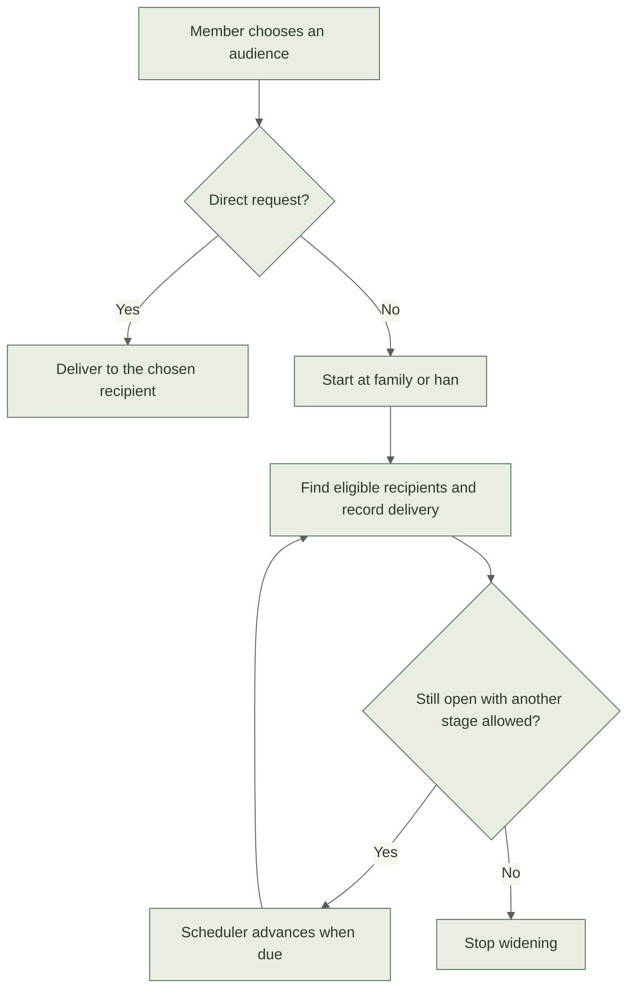
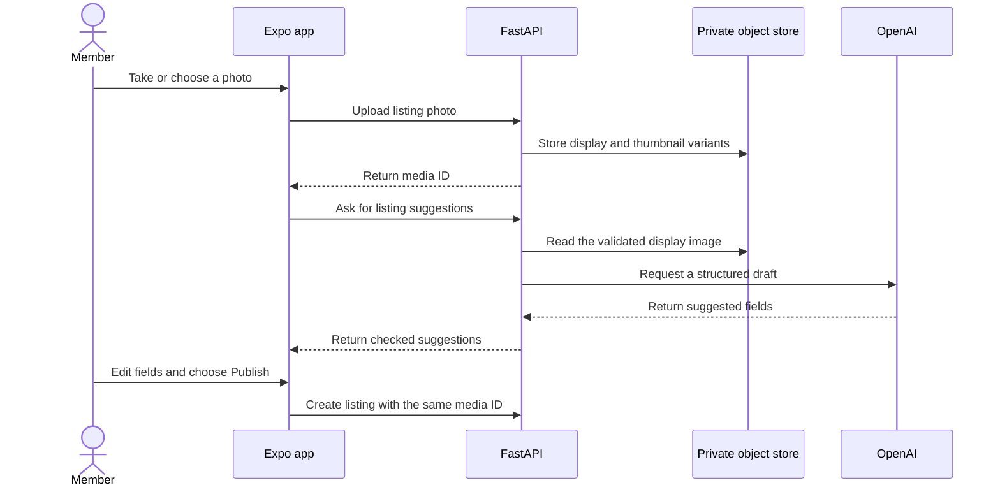
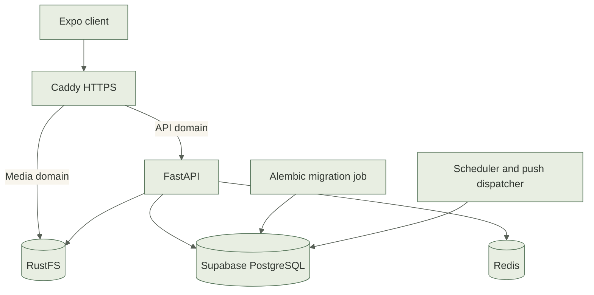

# 設計 · Otagai architecture

[← Project overview](../README.md) · [Original diagram catalogue](diagram-catalogue.md)

Otagai is an Expo and FastAPI monorepo. The server owns access control and state transitions. The app handles form state, localized copy and the review steps where people decide what to share.

| Layer | Responsibility | Entry point |
| --- | --- | --- |
| Mobile | Expo Router screens, typed API calls, and Japanese, English and Bangla UI | [Screens](../mobile/src/app/) · [API client](../mobile/src/lib/api.ts) |
| API | FastAPI routes, Pydantic request validation, Supabase JWT verification, and actor resolution | [Application](../backend/app/main.py) · [dependencies](../backend/app/routes/dependencies.py) |
| Domain | Membership, family consent, requests, exchanges, media, and AI orchestration | [Services](../backend/app/services/) |
| Data | SQLAlchemy repositories, PostgreSQL transactions, and Alembic migrations | [Repositories](../backend/app/repositories/) · [database guide](../backend/docs/database.md) |
| Background | Request widening and push dispatch in dedicated processes. Dramatiq is available through an optional local Compose profile. | [Local Compose](../compose.yaml) · [production Compose](../compose.prod.yaml) |

## 色 · Design system

The interface pairs a warm paper palette with pine green for actions and clay for accents. Shared design tokens define colour, type and touch target sizes. The app uses Inter, Noto Sans JP and Noto Sans Bengali for its three interface languages. [Design tokens](../mobile/src/theme/tokens.json)



## 波紋 · How a request reaches neighbours

An indirect request starts at family or *han*, depending on the selected audience. The server skips stages with no eligible recipients and schedules the next widening attempt six hours after a delivery when another stage is permitted and the request has time left. An accepted offer pauses widening by moving the request out of the open state.



The ripple transaction records in-app notifications and queues eligible devices for push delivery. The dispatcher checks whether a request is still eligible and whether the recipient is in quiet hours. It retries transient failures and checks Expo delivery receipts. [Ripple service](../backend/app/services/requests/ripple.py) · [push setup](request-push-setup.md)

## 出品 · From tool photo to published listing



The draft service checks ownership, upload purpose, and readiness. It resolves the suggested category against the live catalogue and applies the help-only rule to risky categories. The listing service also checks the chosen category when saving. [Mobile add screen](<../mobile/src/app/(community)/tools/add.tsx>) · [AI runner](../backend/app/services/ai/runner.py) · [listing service](../backend/app/services/listings/service.py)

## 守り · Authorization and workflow integrity

- **Family:** The API resolves `X-Acting-For` using the signed-in user and a scoped proxy grant. A family link alone grants no ability to post or read activity on someone’s behalf. [Consent workflow](family-consent.md)
- **Exchanges:** The exchange services track participant decisions independently. Pickup and completion checks prevent one participant from supplying both confirmations. [Exchange services](../backend/app/services/exchanges/) · [handover integration tests](../backend/tests/integration/test_live_handover.py)
- **AI:** Assistant matches use catalogue queries filtered by the actor’s access. The assistant saves a draft and requires a separate confirmation call to create a request. The backend also exposes guided Ask sessions. The legacy mobile Ask screens redirect to the Assistant. [Assistant service](../backend/app/services/assistant/service.py) · [Ask sessions](../backend/app/services/ask_sessions/service.py) · [mobile Ask redirect](<../mobile/src/app/(community)/ask-suggestions.tsx>)

## 配置 · Deployment



Production Compose runs Caddy, the API, workers, Redis and RustFS on a single Docker host. An Alembic job applies database migrations before the API starts. The API uses the internal storage endpoint for object operations and the public HTTPS media hostname for signing client URLs. [Deployment guide](../backend/docs/deployment.md)

### Local media previews

The local Compose API signs media URLs with the internal hostname `s3`. To test previews in a browser on the same machine, run the API on the host after applying migrations. Keep the Compose PostgreSQL, PgBouncer, Redis and RustFS services running. Stop the containerized API to free port 8000.

```bash
# Run from the repository root, using the .env created in the README.
docker compose stop backend
(
  set -a
  . ./.env
  set +a
  export DATABASE_HOST=127.0.0.1 DATABASE_PORT=6432
  export REDIS_HOST=127.0.0.1
  export S3_ENDPOINT_URL=http://127.0.0.1:9000
  export S3_BUCKET=otagai-media S3_ACCESS_KEY=otagai S3_CREATE_BUCKET=true
  cd backend
  uv run --frozen uvicorn main:app --reload
)
```

For physical-device testing, use an API address the device can reach and an HTTPS media endpoint reachable from the device. The [deployment guide](../backend/docs/deployment.md) describes the public media hostname configuration.
