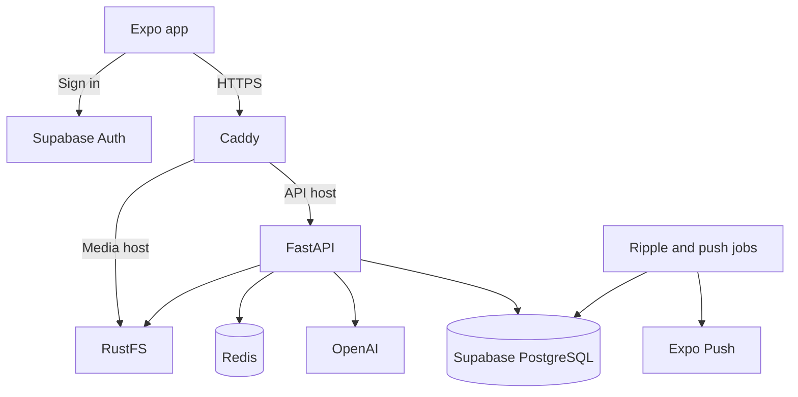

# Architecture

[Project overview](../README.md) · [Local development](development.md)

The Expo app reads and writes domain data through FastAPI. Supabase Auth issues access tokens. The API verifies those tokens and enforces circle membership, proxy consent, and participant permissions before applying state changes.

## Production architecture

Caddy, FastAPI, Redis, RustFS, and the background processes run in Docker Compose. Supabase hosts PostgreSQL and authentication. Caddy routes signed media URLs to RustFS. The ripple scheduler and push dispatcher process requests and outbox rows from PostgreSQL. An Alembic job applies migrations before the API starts. [Production Compose](../compose.prod.yaml) · [Deployment guide](../backend/docs/deployment.md)

## Stack and entry points

| Layer | Technology and responsibility | Source |
| --- | --- | --- |
| App | Expo SDK 58, React Native, TypeScript, Expo Router, and i18next. Screens, API calls, and localized interface copy. | [Routes](../mobile/src/app/) · [API client](../mobile/src/lib/api.ts) |
| Identity | Supabase Auth issues email verification and recovery codes. Brevo relays those emails in production. | [Auth guide](../backend/docs/auth.md) |
| API | FastAPI and Pydantic validate payloads and resolve the signed-in actor. Service code applies access rules and workflow transitions. | [Application](../backend/app/main.py) · [Services](../backend/app/services/) |
| Data | PostgreSQL, SQLAlchemy, and Alembic hold and migrate durable state. Local Compose uses PgBouncer for API connections. | [Database guide](../backend/docs/database.md) |
| Background | Dedicated ripple and push processes read pending work from PostgreSQL. A separate Dramatiq worker handles Redis-backed tasks. | [Scheduler](../backend/app/services/requests/scheduler.py) · [Dispatcher](../backend/app/services/notifications/dispatch.py) · [Worker](../backend/app/services/queue/worker.py) |
| Media | RustFS provides S3-compatible storage. The API processes images and issues short-lived signed URLs for authorized users. | [Media service](../backend/app/services/media/service.py) |

## Request delivery

A direct request goes to its chosen recipient. Other requests carry a current stage, a maximum audience, and a time for the next delivery attempt. The scheduler skips empty stages and can widen delivery six hours after a successful stage when the request is still open, has time left, and permits a wider audience. Accepting an offer moves the request out of its open state. [Ripple service](../backend/app/services/requests/ripple.py)

Deliveries create in-app notifications. Eligible device notifications use a PostgreSQL outbox. The dispatcher checks quiet hours and request state, retries transient failures, and checks Expo receipts. [Dispatcher](../backend/app/services/notifications/dispatch.py) · [Push setup](request-push-setup.md)

## AI and translation

| Interaction | What the backend does | What the user decides |
| --- | --- | --- |
| Ask | The OpenAI Agents SDK returns a typed intent. The catalogue search applies the actor’s access rules. A cached text intent can reuse its interpretation while checking live matches. Voice has a separate transcription call before the text reaches Ask. | Open a match, answer a follow-up question, or review and explicitly confirm a request draft. |
| Tool photo | Validate the uploaded image, generate structured listing suggestions, and check the category and lending rules. | Edit the proposed listing and publish it. |
| Pickup photos | Suggest checks for the handover from submitted evidence. | Review the evidence and confirm independently as each participant. |
| Chat translation | Translate the selected message to the chosen language on demand. | Pick a target language and show or hide the translation in the chat. |

[Assistant service](../backend/app/services/assistant/service.py) · [Assistant API client](../mobile/src/lib/assistant-api.ts) · [AI routes](../backend/app/routes/ai/route.py) · [Handover AI](../backend/app/services/exchanges/handover_ai.py) · [Chat API](../backend/docs/api-endpoints.md)

## Consent and exchange state

The API resolves the `X-Acting-For` header against the signed-in person’s grant. Posting and viewing activity are distinct permissions. The API records who acted and who owns the request. Exchange handover and completion track each participant’s confirmation separately. [Family consent](family-consent.md) · [Handover tests](../backend/tests/integration/test_live_handover.py)
